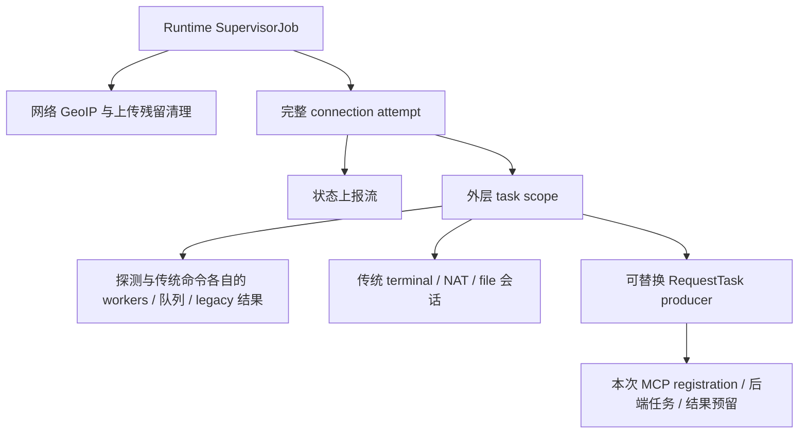

# R1 MCP 运行时

Runtime 现已安装 Task15 Exec、Task16 FsList、Task17 FsRead。Task12–14、18–20 继续返回 `successful=false` 的明确 unsupported。旧 Task4、Task8/9/11 的执行和会话协议继续沿用原入口。

## 组件与作用域

| 组件 | 拥有的状态与职责 |
| --- | --- |
| `AgentRuntime` | 不可变配置快照、根 `SupervisorJob`、start/stop 状态、keepalive、helper owner、上传残留清理和 shutdown coordinator；负责装配平台采集器、gRPC 与执行器 |
| `ConnectionSupervisor` | 完整连接尝试、状态发布、认证/TLS 错误识别及退避；仅本次尝试首次有效状态回执重置退避 |
| `MetricReporter` | 初始主机上报、状态流；GeoIP 借用根 scope 异步获取和补报，原子替换最新 Job，旧 completion 只清自己的引用 |
| `TaskDispatcher` | 唯一能力快照与当前 MCP 引用；外层 task scope、8 个探测 worker/64 条队列、2 个传统命令 worker/16 条队列、legacy 结果通道、MCP 注册和路由 |
| `StreamSessionManager` | 每个外层 task scope 一份，显式借用该 scope；传统 terminal/NAT/file 解析、配额、启动与 lease 释放，不自建后台 scope |

传统流配额仍为总计 36，terminal 2、NAT 32、file 2，StreamID 不超过 256 UTF-8 字节，NAT Host 不超过 1024 字节。配额 acquire、会话 launch 和 completion 释放登记之间没有挂起点。取消到达时即使会话体未运行，也由 Job completion 归还 lease。

主机信息握手 5 秒、状态回执 10 秒、状态上报间隔 2 秒；完整重连使用 5–30 秒上限的 full jitter 退避。TLS 错误继续使用 TLS 重试，不自动降级。

GeoIP 是可失败的附加信息，主机信息上报完成后异步获取，不阻塞状态流和任务流，也不因查询或补报失败重建连接。IPv4/IPv6 各有 4 秒查询期限、60 秒缓存和连续失败 3 次后的 30 秒退避；成功结果立即按地址族保存，不被另一族的超时或调用取消丢弃。两族均不可用或补报失败时，根作用域内的任务等待 30 秒再试；网络回调或下次连接会替换该任务。获取结束后读取当前可用 stub，GeoIP RPC 仍有 5 秒期限，整个获取另有 10 秒兜底期限。停止 Runtime 会取消查询及重试等待。

传统 Task4 命令最多同时执行 2 条，另有 16 条等待；HTTP/ICMP/TCP 等短任务保留 8 个 worker 和 64 条等待。两类队列独立准入，满载时返回明确失败；任务执行前再次检查当前授权，结果仍由原有有界通道传输。任务流空闲替换保留两组 worker，完整连接失败和 Runtime 停止则取消并等待两组任务。

HTTP 探测使用可取消的 OkHttp 异步请求，协程取消会调用 `Call.cancel()`，响应在回调内消费并关闭。网络请求及外层协程均受 15 秒总期限约束，后者也覆盖 OkHttp 排队和平台 DNS 等待；到期返回任务失败，外部取消继续传播。连接/读取超时仍为 10 秒，证书链和主机名验证保持启用。

传统文件管理的高权限保存通过独立 Shell 返回退出码、超时、输出完整性及截断状态。创建目录、复制、权限设置分别产生可辨识的失败状态，全部成功后才检查长度并发送完成标记。同长度旧文件不能代替命令成功。目录枚举以 Java 返回非 null 或 Shell 完整成功为准；成功的空列表保留请求路径。该接口继续使用已有授权及进程登记机制。

## MCP 与能力更新

每次 `RequestTask` 注册都有独立 `McpSession`：最多 2 个 Exec，FsList/FsRead 合计最多 2 个；收到请求时立即准入，容量已满便回传同族 `busy`，不进入旧 8 个短任务 worker。请求以原 JSON 的实际 UTF-8 字节计费，单条上限 1 MiB、会话合计 4 MiB，准入 lease 保留到协调任务完成结果交接或丢弃。

结果的最终 protobuf 上限为 3 MiB，会话预算为 6 MiB。helper transport 在分配 RESULT payload 前预留预算；解析错误、内部错误、撤权和忙响应也先预留 1024 字节再编码。预算等待器按代次广播释放通知，关闭会话唤醒全部等待者。容量为 4 的 Owned 队列持有预算，出站通过单个 flow 直接公平选择旧结果或本会话结果；直到 gRPC 的真正 collector 完成发送或丢弃才归还预算。

准入登记、永久撤权标记和正常结果发布由同一把锁决定。后端 child 在登记后才启动，执行前再查最新授权；关闭 Shell 或 File 权限会取消对应的活动 MCP 后端，并等待其清理/交接，然后在会话仍有效时只回一次同族 `permission_denied`。重新开启权限不会复活旧任务。授权更新不等待网络或结果预算；已经发布的正常结果保留。helper lease 的关闭可能只完成异步清理票交接，不代表所有原生进程已退出。

能力更新只交给 `TaskDispatcher`，不调用 connect/disconnect。传统请求在路由时检查最新能力，已排队短任务在执行时再次读取；已建立的传统长会话按原协议继续，不因切换能力开关被取消。MCP 的活动后端执行上述撤权规则。异步 outgoing 和任务处理捕获所属 registration，禁止通过当前 MCP 指针将旧结果或回调路由到后继注册。

Launcher 按 Runtime 的 `config.rootMode` 选择一次。普通模式不发现高权限后端；Root 失败不降级。Root 模式变更仍需停止服务、保存后再启动。Runtime 不额外启动 su、不发送盲 kill，也不改动 helper 的权限和清理策略。

任务流空闲期限为 360 秒，给最长 300 秒的 Exec 留出传输和收尾时间。同一份最后收包期限同时覆盖 handler 背压和下一次接收。只有内部 idle 到期才重建任务流，其他异常和外部取消正常传播。旧 producer 与全部流内任务取消并 join 后，才关闭旧 MCP 的预算和 Owned 队列、登记新会话；旧终端、NAT 和文件管理长会话仍属于外层 scope。

空闲替换不会取消状态上报、短 worker 或 legacy 结果通道；已从旧结果通道取出但尚未发送完成的 legacy 结果仍可能在替换时丢失，不增加隐式重放。真实流错误会传播到完整连接尝试，等待其所有子任务结束，再由 supervisor 关闭并重建 gRPC 通道。

## 停止完成的含义

前台通知归属单个 `AgentService` 实例。状态更新统一排入主线程，在真正发布前再次检查该实例的通知准入；`onDestroy` 首次同步关闭准入，分别尝试 `stopForeground(REMOVE)` 和取消本包通知 1001，然后提交 Runtime 异步清理。API 23 使用等价的 `stopForeground(true)`。显式取消同时清掉系统已撤销前台关联后留下的普通通知；两个移除动作独立，任一失败不跳过另一个。旧实例排队或晚到的更新被丢弃，重复关闭和异步清理都不再取消共享 ID，避免删除后继实例通知；通知与日志异常不会阻断核心清理。

请求取消或调用单个 helper lease 的 `close()` 不等于原生资源已经退出。Runtime 的挂起 `stop()` 按序关闭 helper 准入、cancel/join 根任务、等待 `HelperLifecycleOwner.close()` 确认原生 IO/process 清理，然后尝试注销网络、关闭 keepalive 和 gRPC。核心清理失败时仍尝试辅助资源释放，但 `stop()` 会报告失败，不能宣称完全停止。

`RuntimeShutdownCoordinator` 记住已经完成的阶段；失败阶段保留所有权供下次重试。Controller 的 pending teardown 与跨 Service gate 在完整清理确认前阻止后继 Runtime，不能用 fire-and-forget 清理取代等待。

UI 模拟器由 `AppContainer` 中独立的 `SimulatorSessionStore` 管理。`requestStop(id)` 同步关准入并请求异步清理，`stopAndAwaitTermination(id)` 才等待会话 Job 和全部已登记原生连接；失败时保留相同对象与 STOPPING 槽。ViewModel 销毁只请求清理，槽的释放不依赖旧 UI scope 存活，也不使用 Service 的 gate。

仅上报真实节点 `Host.version` 的边界使用 `2.1.0+android.<实际 App 版本>`，用于 Dashboard v2.6.1 的 MCP 入口判断。APK 版本、界面版本和模拟节点不随之改变；这个标识只承诺上述 15–17，不能代表 Go Agent 的完整能力。

## 验证边界

机制用例覆盖准入与 UTF-8 计费、预算释放和关闭时多等待者唤醒、最终 collector 阻塞、排队与发送取消、旧会话晚完成、启动前/运行中撤权及同族拒绝语义。组件装配用例进一步观察真实 `TaskDispatcher`/`McpSession`/`StreamSessionManager` 的空闲替换和完整重连、legacy 与短 worker 存活、撤权不重连、配额回收、网络 Job 替换及首回执退避；不会以通用 idle helper 的测试代替装配边界。

JVM 用例在传统解析/执行边界注入合成请求；Android 仪器用例使用默认 `JSONObject` parser、真实准入和替代会话执行器，另验有效 terminal/NAT/file、UTF-8 长度/非法 NAT/重复与超限拒绝及取消释放。Service 的真实 TCP、网络回调、停止与同进程重建仍由 `DeviceRuntimeFixture` 覆盖。具体通过状态以对应提交的实际结果为准，本说明不将新增用例写成已执行结果。

普通模拟器不证明真实 Dashboard MCP 全流程、SukiSU/Shizuku 管理器授权链、厂商后台限制或原发行签名覆盖安装。当前自动化环境、R8 ABI 边界和剩余手工项目见 [设备回归说明](DEVICE_REGRESSIONS.md)；历史面板/手机记录只对当时版本和环境有效。
